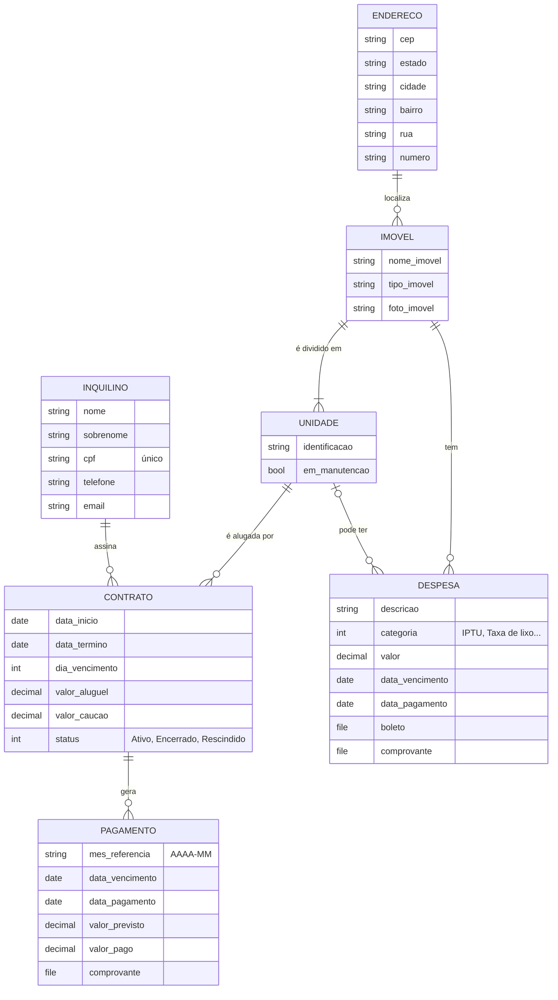

# Gestor Imobiliário — API REST

Projeto final da disciplina **Desenvolvimento Web II** (BSI4 — IFC Araquari).

API REST para uma pessoa gerenciar os próprios imóveis: endereços, imóveis, unidades, inquilinos, contratos de locação, aluguéis recebidos e despesas (IPTU, taxa de lixo, condomínio etc.).

- **Back-end:** Django + Django REST Framework
- **Front-end:** Vue 3 — repositório [gestor-imobiliario-vue](https://github.com/BrunaCristinaBaptista/gestor-imobiliario-vue)
- **Autora:** Bruna Cristina Baptista (trabalho individual)

---

## Sumário

1. [Como executar](#1-como-executar)
2. [Domínio e entidades](#2-domínio-e-entidades)
3. [Regras de negócio](#3-regras-de-negócio) *(Etapa 4)*
4. [Documentação da API](#4-documentação-da-api) *(Etapas 3 a 6)*
5. [Construção passo a passo](#5-construção-passo-a-passo)
6. [Checklist da Parte 8](#6-checklist-da-parte-8)

---

## 1. Como executar

Pré-requisitos: [uv](https://docs.astral.sh/uv/) e Git.

```bash
git clone https://github.com/BrunaCristinaBaptista/
cd gestor-imobiliario-api
uv sync
cp .env_exemplo .env
```

Gere uma chave secreta e cole no campo `SECRET_KEY` do arquivo `.env`:

```bash
uv run python -c "from django.core.management.utils import get_random_secret_key; print(get_random_secret_key())"
```

Crie o banco, carregue os dados de exemplo, crie um usuário administrador e suba o servidor:

```bash
uv run python manage.py migrate
uv run python manage.py loaddata dados_iniciais
uv run python manage.py createsuperuser
uv run python manage.py runserver
```

O `loaddata` é opcional: carrega dados de exemplo para testar (imóveis, unidades, contratos, pagamentos e despesas).

| Recurso | URL |
|---|---|
| Django Admin | http://127.0.0.1:8000/admin/ |
| API | http://127.0.0.1:8000/api/ *(Etapa 3)* |
| Swagger | http://127.0.0.1:8000/api/docs/ *(Etapa 6)* |

---

## 2. Domínio e entidades

O sistema é usado por **uma pessoa** que aluga os próprios imóveis. Um imóvel (ex.: um prédio de kitnets) fica num endereço e é dividido em **unidades** — cada unidade é o que de fato é alugado. Um **contrato** liga uma unidade a um **inquilino** por um período. Cada mês de aluguel gera um **pagamento**, e o imóvel tem **despesas** (IPTU, taxa de lixo, manutenção…), com boleto e comprovante anexados.

### Diagrama



### Entidades

| Model | O que representa | Relacionamentos |
|---|---|---|
| `Endereco` | Localização de um imóvel | — |
| `Imovel` | Construção ou terreno (casa, prédio de kitnets) | pertence a um `Endereco` |
| `Unidade` | Parte alugável de um imóvel (Kitnet 01, Casa Principal) | pertence a um `Imovel` |
| `Inquilino` | Pessoa que aluga uma unidade | — |
| `Contrato` | Locação de uma unidade para um inquilino num período | `Unidade` e `Inquilino` |
| `Pagamento` | Aluguel de um mês de um contrato | pertence a um `Contrato` |
| `Despesa` | Conta do imóvel (IPTU, lixo, manutenção) com boleto e comprovante | `Imovel` e, opcionalmente, `Unidade` |

### Campos calculados (não gravados no banco)

| Model | Campo | Valores | Como é calculado |
|---|---|---|---|
| `Unidade` | `status_atual` | Manutenção, Ocupada, Disponível | em manutenção → *Manutenção*; contrato **Ativo** cobrindo a data de hoje → *Ocupada*; senão *Disponível* |
| `Pagamento` | `status_atual` | Pago, Atrasado, Pendente | tem data de pagamento → *Pago*; vencimento já passou → *Atrasado*; senão *Pendente* |
| `Despesa` | `status_atual` | Paga, Atrasada, Em aberto | mesma lógica do pagamento |

Esses status dependem da **data de hoje**. Se fossem gravados no banco, ficariam desatualizados quando um contrato vencesse ou um boleto atrasasse, porque nenhuma requisição acontece nesse momento. Calculando a cada consulta, estão sempre corretos.

### Regras de integridade no banco

- **CPF único** por inquilino.
- **Identificação única por imóvel**: não existem duas "Kitnet 01" no mesmo imóvel.
- **Um pagamento por mês por contrato**: o mesmo aluguel não é lançado duas vezes.
- **Histórico protegido** (`on_delete=PROTECT`): não é possível excluir um inquilino ou unidade com contrato, um contrato com pagamentos, nem um imóvel com despesas. Para encerrar um contrato, muda-se o status para *Encerrado* ou *Rescindido*.

### Diferenças em relação ao modelo conceitual inicial

O primeiro diagrama (feito no brModelo) foi simplificado durante a implementação:

- A especialização **Unifamiliar/Multifamiliar** virou o campo `tipo_imovel` + a entidade `Unidade`: uma casa é um imóvel com uma unidade; um prédio de kitnets tem várias.
- **Despesas fixas** e **outros gastos** viraram uma única entidade `Despesa` com o campo `categoria`.
- **Aluguel** virou `Pagamento`; **forma de pagamento** foi removida por não ter uso no sistema.

## 3. Regras de negócio

*Preenchido na Etapa 4.*

## 4. Documentação da API

*Preenchido nas Etapas 3 a 6.*

---

## 5. Construção passo a passo

O projeto foi construído seguindo a Parte 7 do material da disciplina (Aulas 17 a 26), com o tutorial `django-drf-tutorial` como apoio para o que o material não cobre (vários models relacionados, frontend, autenticação).

### Etapa 1 — Criação do projeto (Aula 17)

**Objetivo:** criar o projeto Django com o `uv`, separar a configuração global (`config`) da aplicação do domínio (`core`) e manter a chave secreta fora do repositório.

**1.1 Criar a pasta e o ambiente com uv**

```bash
mkdir gestor-imobiliario-api
cd gestor-imobiliario-api
uv init --app --python 3.14 --no-workspace .
rm -f main.py
uv add django python-dotenv
```

- `uv init --app` cria o `pyproject.toml` (lista de dependências do projeto).
- `uv add` instala o pacote e registra a versão exata no `uv.lock`. Quem clonar o projeto instala as mesmas versões com `uv sync`.
- `python-dotenv` lê o arquivo `.env`, onde fica a chave secreta.

**1.2 Criar o projeto `config` e a aplicação `core`**

```bash
uv run django-admin startproject config .
uv run python manage.py startapp core
```

- **Projeto (`config/`)**: configurações globais (`settings.py`) e roteamento principal (`urls.py`).
- **Aplicação (`core/`)**: o módulo do domínio imobiliário — models, serializers, views e admin.
- O `.` no final cria o projeto na pasta atual, sem criar uma subpasta extra.

**1.3 Registrar a aplicação e ajustar idioma e fuso horário**

Em `config/settings.py`:

```python
INSTALLED_APPS = [
    "django.contrib.admin",
    "django.contrib.auth",
    "django.contrib.contenttypes",
    "django.contrib.sessions",
    "django.contrib.messages",
    "django.contrib.staticfiles",
    "core",
]

LANGUAGE_CODE = "pt-br"
TIME_ZONE = "America/Sao_Paulo"
```

**1.4 Tirar a chave secreta do código**

O `startproject` grava uma `SECRET_KEY` dentro do `settings.py`. Se ela for para o GitHub, fica pública para sempre. Por isso ela passa a ser lida do arquivo `.env`, que não é versionado.

No início de `config/settings.py`:

```python
import os
from pathlib import Path

from dotenv import load_dotenv

BASE_DIR = Path(__file__).resolve().parent.parent

load_dotenv(BASE_DIR / ".env")

SECRET_KEY = os.getenv("SECRET_KEY")
DEBUG = os.getenv("DEBUG", "False") == "True"
ALLOWED_HOSTS = os.getenv("ALLOWED_HOSTS", "localhost,127.0.0.1").split(",")
```

> `DEBUG` é comparado com `"True"` porque `os.getenv` sempre devolve texto, e o texto `"False"` seria considerado verdadeiro pelo Python.

Arquivo `.env_exemplo` (versionado, sem segredos):

```ini
SECRET_KEY=troque-por-uma-chave-gerada
DEBUG=True
ALLOWED_HOSTS=localhost,127.0.0.1
```

Criar o `.env` real a partir dele:

```bash
cp .env_exemplo .env
uv run python -c "from django.core.management.utils import get_random_secret_key; print(get_random_secret_key())"
```

**1.5 Arquivo `.gitignore`**

```gitignore
.venv/
__pycache__/
*.py[cod]
db.sqlite3
db.sqlite3-journal
media/
.env
.vscode/
.idea/
```

**1.6 Executar**

```bash
uv run python manage.py runserver
```

Ao acessar http://127.0.0.1:8000/, a página inicial do Django confirma que o projeto funciona. Ainda não há models nem API.

**Estrutura ao final da etapa**

```text
gestor-imobiliario-api/
├── .env_exemplo
├── .gitignore
├── .python-version
├── manage.py
├── pyproject.toml
├── uv.lock
├── config/
│   ├── settings.py
│   ├── urls.py
│   └── ...
└── core/
    ├── admin.py
    ├── models.py
    ├── views.py
    └── migrations/
```

**Commit**

```bash
git add .
git commit -m "feat(django): cria projeto inicial"
```

### Etapa 2 — Models, migrations e Django Admin (Aulas 18 e 19)

**Objetivo:** transformar o domínio em models do Django, criar as tabelas no SQLite com migrations, carregar dados de exemplo e gerenciar tudo pelo Admin, antes de existir qualquer API.

**2.1 Models**

Os 7 models ficam em `core/models.py` (código completo no repositório). O diagrama e a descrição de cada um estão na [seção 2](#2-domínio-e-entidades). Pontos importantes:

- **`ForeignKey` com `related_name`**: permite navegar de volta. Ex.: `imovel.unidades.all()` lista as unidades de um imóvel e `inquilino.contratos.all()` os contratos de um inquilino.
- **`on_delete`**: `PROTECT` impede excluir um registro que ainda é usado por outro (ex.: inquilino com contrato), preservando o histórico; `CASCADE` (só em `Unidade → Imovel`) apaga as unidades junto com o imóvel.
- **`IntegerChoices`** (padrão do tutorial, como o `StatusCompra`): restringem `Contrato.status` e `Despesa.categoria` a valores válidos.

```python
class Contrato(models.Model):
    class Status(models.IntegerChoices):
        ATIVO = 1, "Ativo"
        ENCERRADO = 2, "Encerrado"
        RESCINDIDO = 3, "Rescindido"
    ...
    status = models.IntegerField(choices=Status.choices, default=Status.ATIVO)
```

- **`UniqueConstraint`**: regras de unicidade garantidas pelo próprio banco.

```python
class Meta:
    constraints = (
        models.UniqueConstraint(
            fields=["contrato", "mes_referencia"],
            name="unique_pagamento_por_mes",
        ),
    )
```

- **`@property` para status calculado**: o status da unidade é calculado a partir dos contratos, em vez de ser um campo gravado.

```python
@property
def status_atual(self):
    if self.em_manutencao:
        return "Manutenção"
    hoje = timezone.localdate()
    tem_contrato_vigente = self.contratos.filter(
        status=Contrato.Status.ATIVO,
        data_inicio__lte=hoje,
        data_termino__gte=hoje,
    ).exists()
    if tem_contrato_vigente:
        return "Ocupada"
    return "Disponível"
```

- **`FileField`** para boletos e comprovantes. Os arquivos são salvos na pasta `media/` (não versionada), configurada em `config/settings.py`:

```python
MEDIA_URL = "media/"
MEDIA_ROOT = BASE_DIR / "media"
```

E, em desenvolvimento, servidos pelo próprio Django em `config/urls.py`:

```python
if settings.DEBUG:
    urlpatterns += static(settings.MEDIA_URL, document_root=settings.MEDIA_ROOT)
```

**2.2 Migrations**

```bash
uv run python manage.py makemigrations
uv run python manage.py migrate
uv run python manage.py showmigrations
uv run python manage.py check
```

- `makemigrations` lê os models e gera o arquivo `core/migrations/0001_initial.py`, que descreve as tabelas.
- `migrate` aplica esse arquivo no `db.sqlite3`, criando as tabelas.
- `showmigrations` mostra o que foi aplicado (`[X]`) e `check` verifica a consistência do projeto.

**2.3 Dados de exemplo**

O arquivo `core/fixtures/dados_iniciais.json` tem endereços, imóveis, unidades, inquilinos, contratos, pagamentos e despesas para testes e para a apresentação:

```bash
uv run python manage.py loaddata dados_iniciais
```

Os dados foram montados para demonstrar todos os status calculados:

| Registro | Situação | Status esperado |
|---|---|---|
| Kitnet 01 | contrato ativo de 03/2026 a 02/2027 | Ocupada |
| Kitnet 02 | contrato rescindido | Disponível |
| Kitnet 03 | marcada como em manutenção | Manutenção |
| Pagamento 2026-10 da Kitnet 01 | venceu em 10/10/2026 e não foi pago | Atrasado (após 10/10/2026) |
| Despesa "Taxa de coleta de lixo 2026" | vence em 30/11/2026, sem pagamento | Em aberto |

**2.4 Django Admin**

Em `core/admin.py`, cada model é registrado com `@admin.register` e configurado com `list_display` (colunas), `search_fields` (busca) e `list_filter` (filtros laterais). Os status calculados aparecem como coluna:

```python
@admin.register(Unidade)
class UnidadeAdmin(admin.ModelAdmin):
    list_display = ("id", "identificacao", "imovel", "em_manutencao", "status_atual")
    search_fields = ("identificacao", "imovel__nome_imovel")
    list_filter = ("imovel", "em_manutencao")
```

Também foram usados `TabularInline` (tutorial, seção 26): as unidades são cadastradas dentro da tela do imóvel, e os pagamentos aparecem dentro da tela do contrato.

```bash
uv run python manage.py createsuperuser
uv run python manage.py runserver
```

Em http://127.0.0.1:8000/admin/:

1. Em **Unidades**, conferir os status da tabela acima.
2. Abrir o contrato da Kitnet 01, mudar o status para **Rescindido** e salvar: a Kitnet 01 passa a **Disponível**. Voltar para **Ativo**: volta a **Ocupada**.
3. Tentar excluir o inquilino Carlos Ferreira: o Admin recusa, porque ele tem contrato (`PROTECT`).
4. Tentar cadastrar um segundo pagamento `2026-10` para o mesmo contrato: o Admin recusa (`UniqueConstraint`).
5. Abrir a despesa "Taxa de coleta de lixo 2026", anexar um PDF no campo **boleto** e salvar: o link do arquivo abre o boleto.

**2.5 Consultas no Django Shell**

```bash
uv run python manage.py shell
```

```python
from core.models import Imovel, Unidade, Inquilino
Imovel.objects.get(pk=1).unidades.all()
Unidade.objects.get(pk=1).status_atual
Inquilino.objects.get(pk=1).contratos.all()
```

**Commit**

```bash
git add .
git commit -m "feat(core): adiciona models, migrations, admin e dados iniciais"
```

---

## 6. Checklist da Parte 8

**Obrigatório**

- [x] Escolhi um domínio próprio, diferente da simples reprodução da API de Produtos.
- [ ] Implementei `GET` da coleção, `GET` individual, `POST`, `PUT` e `DELETE`.
- [ ] Utilizei códigos HTTP adequados e respostas em JSON quando aplicável.
- [x] Os dados estão persistidos em um banco de dados.
- [ ] Defini e implementei validações no backend.
- [ ] Implementei pelo menos uma regra de negócio além do CRUD.
- [ ] Implementei filtro, busca textual, ordenação e paginação.
- [ ] Documentei a API e as instruções de execução.
- [x] Versionei o código em um repositório Git.
- [ ] Informei todas as URLs necessárias para avaliação.
- [ ] Preparei a demonstração e a explicação do projeto para a apresentação obrigatória.
- [ ] Realizei a entrega pelo SIGAA, enviando o link do repositório GitHub do projeto.
- [ ] Estou preparado para apresentar o projeto em sala de aula, para toda a turma, após a data de entrega.
- [ ] Testei a aplicação após instalar e configurar o projeto seguindo o `README`.

**Opcional**

- [ ] Publiquei a aplicação.
- [ ] Criei um frontend integrado à API.
- [x] Implementei 3 ou mais models/tabelas relevantes para o domínio.
- [ ] Implementei e testei login, autenticação e acesso a pelo menos um recurso protegido.
- [x] Removi do repositório credenciais, senhas e chaves privadas.
