# Gestor Imobiliário — API REST

Projeto final da disciplina **Desenvolvimento Web II** (BSI4 — IFC Araquari).

API REST para uma pessoa gerenciar os próprios imóveis: endereços, imóveis, unidades, inquilinos, contratos de locação, aluguéis recebidos e despesas (IPTU, taxa de lixo, condomínio etc.).

- **Back-end:** Django + Django REST Framework
- **Front-end:** Vue 3 — repositório [gestor-imobiliario-vue](https://github.com/BrunaCristinaBaptista/gestor-imobiliario-vue)
- **Autora:** Bruna Cristina Baptista (trabalho individual)

---

## Sumário

1. [Como executar](#1-como-executar)
2. [Domínio e entidades](#2-domínio-e-entidades)
3. [Regras de negócio](#3-regras-de-negócio)
4. [Documentação da API](#4-documentação-da-api) *(Swagger na Etapa 6)*
5. [Construção passo a passo](#5-construção-passo-a-passo)
6. [Checklist da Parte 8](#6-checklist-da-parte-8)

---

## 1. Como executar

Pré-requisitos: [uv](https://docs.astral.sh/uv/) e Git.

```bash
git clone https://github.com/BrunaCristinaBaptista/gestor-imobiliario-api.git
cd gestor-imobiliario-api
uv sync
cp .env_exemplo .env
```

Gere uma chave secreta e cole no campo `SECRET_KEY` do arquivo `.env`:

```bash
uv run python -c "from django.core.management.utils import get_random_secret_key; print(get_random_secret_key())"
```

Crie o banco, carregue os dados de exemplo, crie um usuário administrador e suba o servidor:

```bash
uv run python manage.py migrate
uv run python manage.py loaddata dados_iniciais
uv run python manage.py createsuperuser
uv run python manage.py runserver
```

O `loaddata` é opcional: carrega dados de exemplo para testar (imóveis, unidades, contratos, pagamentos e despesas).

| Recurso | URL |
|---|---|
| Django Admin | http://127.0.0.1:8000/admin/ |
| API (interface navegável do DRF) | http://127.0.0.1:8000/api/ |
| Swagger | http://127.0.0.1:8000/api/docs/ *(Etapa 6)* |

---

## 2. Domínio e entidades

O sistema é usado por **uma pessoa** que aluga os próprios imóveis. Um imóvel (ex.: um prédio de kitnets) fica num endereço e é dividido em **unidades** — cada unidade é o que de fato é alugado. Um **contrato** liga uma unidade a um **inquilino** por um período. Cada mês de aluguel gera um **pagamento**, e o imóvel tem **despesas** (IPTU, taxa de lixo, manutenção…), com boleto e comprovante anexados.

### Diagrama

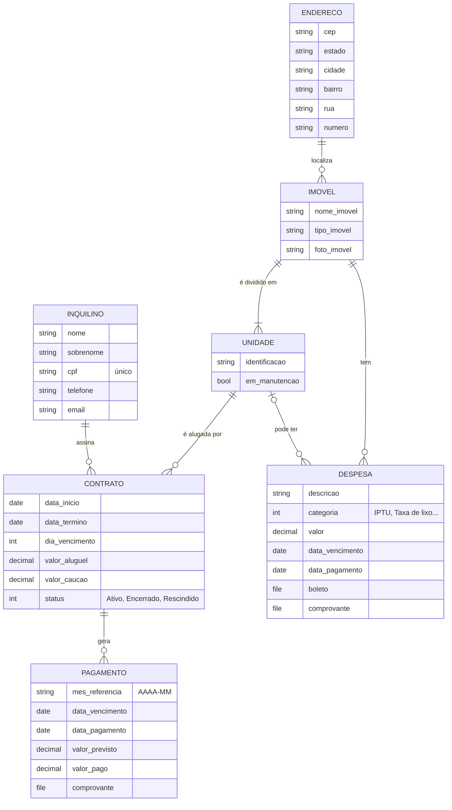

### Entidades

| Model | O que representa | Relacionamentos |
|---|---|---|
| `Endereco` | Localização de um imóvel | — |
| `Imovel` | Construção ou terreno (casa, prédio de kitnets) | pertence a um `Endereco` |
| `Unidade` | Parte alugável de um imóvel (Kitnet 01, Casa Principal) | pertence a um `Imovel` |
| `Inquilino` | Pessoa que aluga uma unidade | — |
| `Contrato` | Locação de uma unidade para um inquilino num período | `Unidade` e `Inquilino` |
| `Pagamento` | Aluguel de um mês de um contrato | pertence a um `Contrato` |
| `Despesa` | Conta do imóvel (IPTU, lixo, manutenção) com boleto e comprovante | `Imovel` e, opcionalmente, `Unidade` |

### Campos calculados (não gravados no banco)

| Model | Campo | Valores | Como é calculado |
|---|---|---|---|
| `Unidade` | `status_atual` | Manutenção, Ocupada, Disponível | em manutenção → *Manutenção*; contrato **Ativo** cobrindo a data de hoje → *Ocupada*; senão *Disponível* |
| `Pagamento` | `status_atual` | Pago, Atrasado, Pendente | tem data de pagamento → *Pago*; vencimento já passou → *Atrasado*; senão *Pendente* |
| `Despesa` | `status_atual` | Paga, Atrasada, Em aberto | mesma lógica do pagamento |

Esses status dependem da **data de hoje**. Se fossem gravados no banco, ficariam desatualizados quando um contrato vencesse ou um boleto atrasasse, porque nenhuma requisição acontece nesse momento. Calculando a cada consulta, estão sempre corretos.

### Regras de integridade no banco

- **CPF único** por inquilino.
- **Identificação única por imóvel**: não existem duas "Kitnet 01" no mesmo imóvel.
- **Um pagamento por mês por contrato**: o mesmo aluguel não é lançado duas vezes.
- **Histórico protegido** (`on_delete=PROTECT`): não é possível excluir um inquilino ou unidade com contrato, um contrato com pagamentos, nem um imóvel com despesas. Para encerrar um contrato, muda-se o status para *Encerrado* ou *Rescindido*.

### Diferenças em relação ao modelo conceitual inicial

O primeiro diagrama (feito no brModelo) foi simplificado durante a implementação:

- A especialização **Unifamiliar/Multifamiliar** virou o campo `tipo_imovel` + a entidade `Unidade`: uma casa é um imóvel com uma unidade; um prédio de kitnets tem várias.
- **Despesas fixas** e **outros gastos** viraram uma única entidade `Despesa` com o campo `categoria`.
- **Aluguel** virou `Pagamento`; **forma de pagamento** foi removida por não ter uso no sistema.

## 3. Regras de negócio

As regras ficam no back-end, nos serializers (`core/serializers.py`), e podem ser verificadas pela API: quando uma regra é violada, a resposta é **400** com a mensagem no campo envolvido.

### Regra principal: ocupação da unidade

1. **Status calculado.** O `status_atual` da unidade é calculado a cada consulta: *Manutenção* se estiver marcada como em manutenção; *Ocupada* se houver contrato **Ativo** cobrindo a data de hoje; senão *Disponível*. Rescindir ou encerrar um contrato libera a unidade automaticamente, e um contrato que vence deixa de ocupá-la no dia seguinte, sem nenhuma ação manual.
2. **Contratos sobrepostos.** Uma unidade não pode ter dois contratos **ativos** com períodos que se sobrepõem. Dois períodos se sobrepõem quando um começa antes do outro terminar:

   ```text
   existente.data_inicio <= novo.data_termino  E  existente.data_termino >= novo.data_inicio
   ```

   Contratos encerrados ou rescindidos não bloqueiam. Ao editar um contrato, ele não é comparado com ele mesmo.
3. **Unidade em manutenção** não pode receber um contrato novo.

Exemplo: com o contrato #1 ativo na Kitnet 01 de 01/03/2026 a 28/02/2027, este `POST /api/contratos/` é recusado:

```json
{ "unidade": 1, "inquilino": 2, "data_inicio": "2026-12-01", "data_termino": "2027-11-30",
  "dia_vencimento": 10, "valor_aluguel": "1000.00", "status": 1 }
```

```json
{
  "unidade": [
    "Esta unidade já tem o contrato #1 ativo de 01/03/2026 a 28/02/2027, que se sobrepõe ao período informado."
  ]
}
```

### Regras do financeiro

- O **mês de referência** de um pagamento precisa estar dentro da vigência do contrato.
- **Um pagamento por mês** por contrato (restrição no banco).
- **Data de pagamento e valor pago** são informados juntos: ou o pagamento está registrado (os dois), ou está pendente (nenhum).
- A **data de pagamento** não pode ser futura.
- A **unidade de uma despesa** precisa pertencer ao imóvel da despesa.

### Validações de campo

| Model | Campo | Regra |
|---|---|---|
| Endereço | `cep` | 8 dígitos; gravado como `00000-000` |
| Endereço | `estado` | sigla de UF válida; gravada em maiúsculas |
| Endereço | `cidade`, `bairro`, `rua` | pelo menos 2 caracteres |
| Imóvel | `nome_imovel`, `tipo_imovel` | pelo menos 2 caracteres |
| Unidade | `identificacao` | pelo menos 2 caracteres; única por imóvel |
| Inquilino | `nome`, `sobrenome` | pelo menos 2 caracteres |
| Inquilino | `cpf` | dígitos verificadores válidos; único; gravado como `000.000.000-00` |
| Inquilino | `telefone` | DDD + número (10 ou 11 dígitos); gravado como `(00) 00000-0000` |
| Contrato | `data_termino` | posterior à `data_inicio` |
| Contrato | `dia_vencimento` | de 1 a 28 (todo mês tem pelo menos 28 dias) |
| Contrato | `valor_aluguel` | maior que zero |
| Contrato | `valor_caucao` | não negativo |
| Contrato | `numero_parcelas_caucao` | pelo menos 1 |
| Pagamento | `mes_referencia` | formato `AAAA-MM` |
| Pagamento | `valor_previsto`, `valor_pago` | maiores que zero |
| Despesa | `descricao` | pelo menos 3 caracteres |
| Despesa | `valor` | maior que zero |
| Pagamento e Despesa | arquivos | PDF, PNG ou JPG, até 5 MB |

Além dessas, o próprio `ModelSerializer` aplica as regras dos models: campos obrigatórios, tamanho máximo, tipos (data, número, decimal), valores das `choices` e unicidade.

## 4. Documentação da API

Todas as rotas ficam sob `/api/` e recebem e devolvem **JSON**. A documentação interativa (Swagger) será adicionada na Etapa 6.

### Recursos

| Recurso | Coleção | Item |
|---|---|---|
| Endereços | `/api/enderecos/` | `/api/enderecos/{id}/` |
| Imóveis | `/api/imoveis/` | `/api/imoveis/{id}/` |
| Unidades | `/api/unidades/` | `/api/unidades/{id}/` |
| Inquilinos | `/api/inquilinos/` | `/api/inquilinos/{id}/` |
| Contratos | `/api/contratos/` | `/api/contratos/{id}/` |
| Pagamentos | `/api/pagamentos/` | `/api/pagamentos/{id}/` |
| Despesas | `/api/despesas/` | `/api/despesas/{id}/` |

### Operações e códigos HTTP

| Operação | Método | URL | Sucesso | Erros |
|---|---|---|---|---|
| Listar | `GET` | coleção | `200` (paginado) | `400` parâmetro de consulta inválido |
| Detalhar | `GET` | item | `200` | `404` id inexistente |
| Criar | `POST` | coleção | `201` | `400` dados inválidos |
| Atualizar (completo) | `PUT` | item | `200` | `400` / `404` |
| Atualizar (parcial) | `PATCH` | item | `200` | `400` / `404` |
| Excluir | `DELETE` | item | `204` (sem corpo) | `400` registro em uso / `404` |

Formato dos erros:

- `404`: `{ "detail": "No Contrato matches the given query." }`
- `400` de validação ou de regra de negócio: um item por campo, ex. `{ "inquilino": ["Este campo é obrigatório."] }` ou `{ "unidade": ["Esta unidade já tem o contrato #1 ativo..."] }`
- `400` ao excluir registro em uso: `{ "detail": "Não é possível excluir este registro porque existem outros registros vinculados a ele." }`

### Consultas: filtro, busca, ordenação e paginação

Todas as coleções aceitam os mesmos parâmetros de consulta, que podem ser combinados:

| Parâmetro | Exemplo | Efeito |
|---|---|---|
| filtros (por recurso, tabela abaixo) | `?status=1&valor_minimo=900` | condições exatas ou por faixa |
| `search` | `?search=kitnet` | busca parcial, sem diferenciar maiúsculas, nos campos de texto do recurso |
| `ordering` | `?ordering=-valor_aluguel` | ordena pelo campo; `-` para decrescente; vários campos separados por vírgula |
| `page` | `?page=2` | número da página (padrão `1`) |
| `page_size` | `?page_size=20` | itens por página (padrão `10`, máximo `100`) |

A resposta das listagens é paginada, no mesmo formato das Partes 1 a 6 da disciplina:

```json
{
  "page": 1,
  "page_size": 10,
  "total_pages": 1,
  "results": [ ... ]
}
```

A ordem de aplicação é: filtros → busca → ordenação → paginação. Uma página além da última devolve `200` com `results` vazio; `page=0` ou `page_size` acima de 100 devolvem `400`.

| Recurso | Filtros | `search` procura em | `ordering` aceita |
|---|---|---|---|
| Endereços | `estado`, `cidade` | rua, bairro, cidade, CEP | `id`, `cidade`, `bairro`, `rua` |
| Imóveis | `tipo_imovel`, `cidade`, `endereco` | nome, tipo, rua, bairro, cidade | `id`, `nome_imovel`, `tipo_imovel` |
| Unidades | `imovel`, `em_manutencao` | identificação, nome do imóvel | `id`, `identificacao`, `imovel__nome_imovel` |
| Inquilinos | — | nome, sobrenome, CPF, e-mail, telefone | `id`, `nome`, `sobrenome` |
| Contratos | `status`, `unidade`, `inquilino`, `imovel`, `valor_minimo`, `valor_maximo` | nome e sobrenome do inquilino, unidade, imóvel | `id`, `data_inicio`, `data_termino`, `valor_aluguel`, `status` |
| Pagamentos | `contrato`, `mes_referencia`, `em_aberto`, `vencimento_minimo`, `vencimento_maximo` | mês, nome do inquilino, unidade | `id`, `mes_referencia`, `data_vencimento`, `data_pagamento`, `valor_previsto` |
| Despesas | `imovel`, `unidade`, `categoria`, `em_aberto`, `valor_minimo`, `valor_maximo`, `vencimento_minimo`, `vencimento_maximo` | descrição, imóvel, unidade | `id`, `data_vencimento`, `valor`, `categoria`, `descricao` |

Exemplos:

- Boletos em aberto de um imóvel, do vencimento mais próximo ao mais distante: `GET /api/despesas/?imovel=1&em_aberto=true&ordering=data_vencimento`
- Aluguéis atrasados ou pendentes: `GET /api/pagamentos/?em_aberto=true`
- Contratos ativos com aluguel entre R$ 900 e R$ 2.000, do maior para o menor: `GET /api/contratos/?status=1&valor_minimo=900&valor_maximo=2000&ordering=-valor_aluguel`
- IPTU de 2026: `GET /api/despesas/?categoria=1&vencimento_minimo=2026-01-01&vencimento_maximo=2026-12-31`

> O `status_atual` (Ocupada, Atrasado, Em aberto…) é calculado em Python, não é uma coluna do banco, por isso não pode ser usado como filtro. Para pagamentos e despesas, o filtro `em_aberto` cobre a necessidade: ele consulta se `data_pagamento` está vazia.

### Campos de leitura

Cada chave estrangeira é **enviada e recebida pelo id** (ex.: `"unidade": 1`). Para facilitar a leitura, a resposta traz também campos somente leitura:

| Campo | Exemplo | Origem |
|---|---|---|
| `<relação>_descricao` | `"unidade_descricao": "Residencial Palmeiras - Kitnet 01"` | `__str__` do registro relacionado |
| `status_display` / `categoria_display` | `"status_display": "Ativo"` | rótulo do `IntegerChoices` |
| `status_atual` | `"status_atual": "Ocupada"` | campo calculado do model |

Campos somente leitura são ignorados se forem enviados num `POST` ou `PUT`.

### Exemplo: criar um contrato

`POST /api/contratos/`

```json
{
  "unidade": 2,
  "inquilino": 2,
  "data_inicio": "2027-01-01",
  "data_termino": "2027-12-31",
  "dia_vencimento": 5,
  "valor_aluguel": "920.00",
  "valor_caucao": "0.00",
  "numero_parcelas_caucao": 1,
  "status": 1
}
```

Resposta `201 Created`:

```json
{
  "id": 4,
  "unidade": 2,
  "unidade_descricao": "Residencial Palmeiras - Kitnet 02",
  "inquilino": 2,
  "inquilino_descricao": "Ana Souza",
  "data_inicio": "2027-01-01",
  "data_termino": "2027-12-31",
  "dia_vencimento": 5,
  "valor_aluguel": "920.00",
  "valor_caucao": "0.00",
  "numero_parcelas_caucao": 1,
  "status": 1,
  "status_display": "Ativo"
}
```

### Valores dos campos com opções

| Campo | Valores |
|---|---|
| `Contrato.status` | `1` Ativo, `2` Encerrado, `3` Rescindido |
| `Despesa.categoria` | `1` IPTU, `2` Taxa de lixo, `3` Condomínio, `4` Água, `5` Energia, `6` Seguro, `7` Manutenção, `8` Outra |

### Arquivos (boleto e comprovante)

`Despesa.boleto`, `Despesa.comprovante` e `Pagamento.comprovante` são opcionais. Para enviar um arquivo, a requisição precisa ser `multipart/form-data` em vez de JSON. Na interface navegável do DRF, use a aba **HTML form**, que já envia nesse formato.

---

## 5. Construção passo a passo

O projeto foi construído seguindo a Parte 7 do material da disciplina (Aulas 17 a 26), com o tutorial `django-drf-tutorial` como apoio para o que o material não cobre (vários models relacionados, frontend, autenticação).

### Etapa 1 — Criação do projeto (Aula 17)

**Objetivo:** criar o projeto Django com o `uv`, separar a configuração global (`config`) da aplicação do domínio (`core`) e manter a chave secreta fora do repositório.

**1.1 Criar a pasta e o ambiente com uv**

```bash
mkdir gestor-imobiliario-api
cd gestor-imobiliario-api
uv init --app --python 3.14 --no-workspace .
rm -f main.py
uv add django python-dotenv
```

- `uv init --app` cria o `pyproject.toml` (lista de dependências do projeto).
- `uv add` instala o pacote e registra a versão exata no `uv.lock`. Quem clonar o projeto instala as mesmas versões com `uv sync`.
- `python-dotenv` lê o arquivo `.env`, onde fica a chave secreta.

**1.2 Criar o projeto `config` e a aplicação `core`**

```bash
uv run django-admin startproject config .
uv run python manage.py startapp core
```

- **Projeto (`config/`)**: configurações globais (`settings.py`) e roteamento principal (`urls.py`).
- **Aplicação (`core/`)**: o módulo do domínio imobiliário — models, serializers, views e admin.
- O `.` no final cria o projeto na pasta atual, sem criar uma subpasta extra.

**1.3 Registrar a aplicação e ajustar idioma e fuso horário**

Em `config/settings.py`:

```python
INSTALLED_APPS = [
    "django.contrib.admin",
    "django.contrib.auth",
    "django.contrib.contenttypes",
    "django.contrib.sessions",
    "django.contrib.messages",
    "django.contrib.staticfiles",
    "core",
]

LANGUAGE_CODE = "pt-br"
TIME_ZONE = "America/Sao_Paulo"
```

**1.4 Tirar a chave secreta do código**

O `startproject` grava uma `SECRET_KEY` dentro do `settings.py`. Se ela for para o GitHub, fica pública para sempre. Por isso ela passa a ser lida do arquivo `.env`, que não é versionado.

No início de `config/settings.py`:

```python
import os
from pathlib import Path

from dotenv import load_dotenv

BASE_DIR = Path(__file__).resolve().parent.parent

load_dotenv(BASE_DIR / ".env")

SECRET_KEY = os.getenv("SECRET_KEY")
DEBUG = os.getenv("DEBUG", "False") == "True"
ALLOWED_HOSTS = os.getenv("ALLOWED_HOSTS", "localhost,127.0.0.1").split(",")
```

> `DEBUG` é comparado com `"True"` porque `os.getenv` sempre devolve texto, e o texto `"False"` seria considerado verdadeiro pelo Python.

Arquivo `.env_exemplo` (versionado, sem segredos):

```ini
SECRET_KEY=troque-por-uma-chave-gerada
DEBUG=True
ALLOWED_HOSTS=localhost,127.0.0.1
```

Criar o `.env` real a partir dele:

```bash
cp .env_exemplo .env
uv run python -c "from django.core.management.utils import get_random_secret_key; print(get_random_secret_key())"
```

**1.5 Arquivo `.gitignore`**

```gitignore
.venv/
__pycache__/
*.py[cod]
db.sqlite3
db.sqlite3-journal
media/
.env
.vscode/
.idea/
```

**1.6 Executar**

```bash
uv run python manage.py runserver
```

Ao acessar http://127.0.0.1:8000/, a página inicial do Django confirma que o projeto funciona. Ainda não há models nem API.

**Estrutura ao final da etapa**

```text
gestor-imobiliario-api/
├── .env_exemplo
├── .gitignore
├── .python-version
├── manage.py
├── pyproject.toml
├── uv.lock
├── config/
│   ├── settings.py
│   ├── urls.py
│   └── ...
└── core/
    ├── admin.py
    ├── models.py
    ├── views.py
    └── migrations/
```

**Commit**

```bash
git add .
git commit -m "feat(django): cria projeto inicial"
```

### Etapa 2 — Models, migrations e Django Admin (Aulas 18 e 19)

**Objetivo:** transformar o domínio em models do Django, criar as tabelas no SQLite com migrations, carregar dados de exemplo e gerenciar tudo pelo Admin, antes de existir qualquer API.

**2.1 Models**

Os 7 models ficam em `core/models.py` (código completo no repositório). O diagrama e a descrição de cada um estão na [seção 2](#2-domínio-e-entidades). Pontos importantes:

- **`ForeignKey` com `related_name`**: permite navegar de volta. Ex.: `imovel.unidades.all()` lista as unidades de um imóvel e `inquilino.contratos.all()` os contratos de um inquilino.
- **`on_delete`**: `PROTECT` impede excluir um registro que ainda é usado por outro (ex.: inquilino com contrato), preservando o histórico; `CASCADE` (só em `Unidade → Imovel`) apaga as unidades junto com o imóvel.
- **`IntegerChoices`** (padrão do tutorial, como o `StatusCompra`): restringem `Contrato.status` e `Despesa.categoria` a valores válidos.

```python
class Contrato(models.Model):
    class Status(models.IntegerChoices):
        ATIVO = 1, "Ativo"
        ENCERRADO = 2, "Encerrado"
        RESCINDIDO = 3, "Rescindido"
    ...
    status = models.IntegerField(choices=Status.choices, default=Status.ATIVO)
```

- **`UniqueConstraint`**: regras de unicidade garantidas pelo próprio banco.

```python
class Meta:
    constraints = (
        models.UniqueConstraint(
            fields=["contrato", "mes_referencia"],
            name="unique_pagamento_por_mes",
        ),
    )
```

- **`@property` para status calculado**: o status da unidade é calculado a partir dos contratos, em vez de ser um campo gravado.

```python
@property
def status_atual(self):
    if self.em_manutencao:
        return "Manutenção"
    hoje = timezone.localdate()
    tem_contrato_vigente = self.contratos.filter(
        status=Contrato.Status.ATIVO,
        data_inicio__lte=hoje,
        data_termino__gte=hoje,
    ).exists()
    if tem_contrato_vigente:
        return "Ocupada"
    return "Disponível"
```

- **`FileField`** para boletos e comprovantes. Os arquivos são salvos na pasta `media/` (não versionada), configurada em `config/settings.py`:

```python
MEDIA_URL = "media/"
MEDIA_ROOT = BASE_DIR / "media"
```

E, em desenvolvimento, servidos pelo próprio Django em `config/urls.py`:

```python
if settings.DEBUG:
    urlpatterns += static(settings.MEDIA_URL, document_root=settings.MEDIA_ROOT)
```

**2.2 Migrations**

```bash
uv run python manage.py makemigrations
uv run python manage.py migrate
uv run python manage.py showmigrations
uv run python manage.py check
```

- `makemigrations` lê os models e gera o arquivo `core/migrations/0001_initial.py`, que descreve as tabelas.
- `migrate` aplica esse arquivo no `db.sqlite3`, criando as tabelas.
- `showmigrations` mostra o que foi aplicado (`[X]`) e `check` verifica a consistência do projeto.

**2.3 Dados de exemplo**

O arquivo `core/fixtures/dados_iniciais.json` tem endereços, imóveis, unidades, inquilinos, contratos, pagamentos e despesas para testes e para a apresentação:

```bash
uv run python manage.py loaddata dados_iniciais
```

Os dados foram montados para demonstrar todos os status calculados:

| Registro | Situação | Status esperado |
|---|---|---|
| Kitnet 01 | contrato ativo de 03/2026 a 02/2027 | Ocupada |
| Kitnet 02 | contrato rescindido | Disponível |
| Kitnet 03 | marcada como em manutenção | Manutenção |
| Pagamento 2026-10 da Kitnet 01 | venceu em 10/10/2026 e não foi pago | Atrasado (após 10/10/2026) |
| Despesa "Taxa de coleta de lixo 2026" | vence em 30/11/2026, sem pagamento | Em aberto |

**2.4 Django Admin**

Em `core/admin.py`, cada model é registrado com `@admin.register` e configurado com `list_display` (colunas), `search_fields` (busca) e `list_filter` (filtros laterais). Os status calculados aparecem como coluna:

```python
@admin.register(Unidade)
class UnidadeAdmin(admin.ModelAdmin):
    list_display = ("id", "identificacao", "imovel", "em_manutencao", "status_atual")
    search_fields = ("identificacao", "imovel__nome_imovel")
    list_filter = ("imovel", "em_manutencao")
```

Também foram usados `TabularInline` (tutorial, seção 26): as unidades são cadastradas dentro da tela do imóvel, e os pagamentos aparecem dentro da tela do contrato.

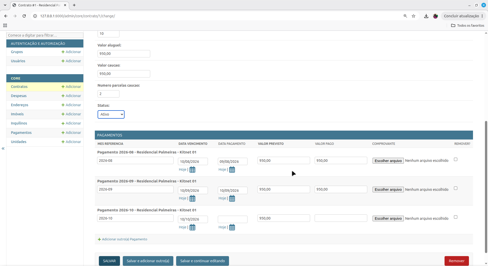

```bash
uv run python manage.py createsuperuser
uv run python manage.py runserver
```

Em http://127.0.0.1:8000/admin/:

1. Em **Unidades**, conferir os status da tabela acima.
2. Abrir o contrato da Kitnet 01, mudar o status para **Rescindido** e salvar: a Kitnet 01 passa a **Disponível**. Voltar para **Ativo**: volta a **Ocupada**.
3. Tentar excluir o inquilino Carlos Ferreira: o Admin recusa, porque ele tem contrato (`PROTECT`).
4. Tentar cadastrar um segundo pagamento `2026-10` para o mesmo contrato: o Admin recusa (`UniqueConstraint`).
5. Abrir a despesa "Taxa de coleta de lixo 2026", anexar um PDF no campo **boleto** e salvar: o link do arquivo abre o boleto.

Resultado dos testes:

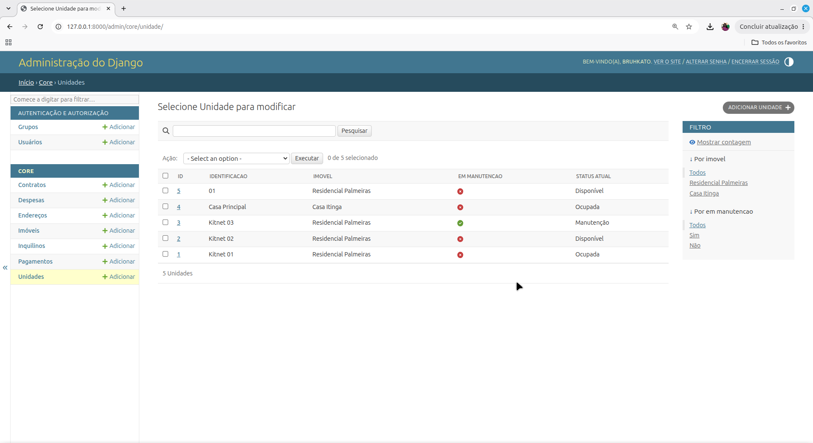

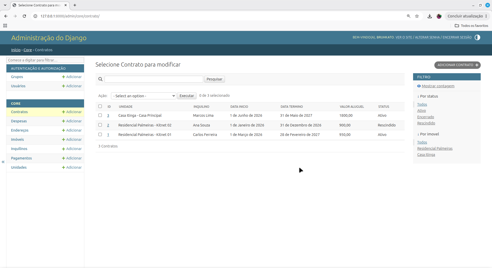

Contrato da Kitnet 01 alterado para **Rescindido** e a unidade passando a **Disponível**:

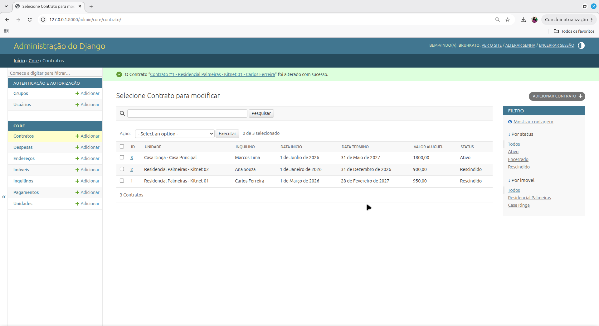
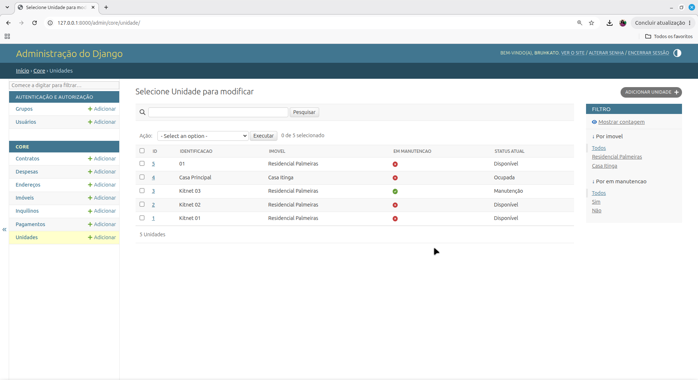

Status calculado dos pagamentos e pagamento duplicado recusado pelo banco:

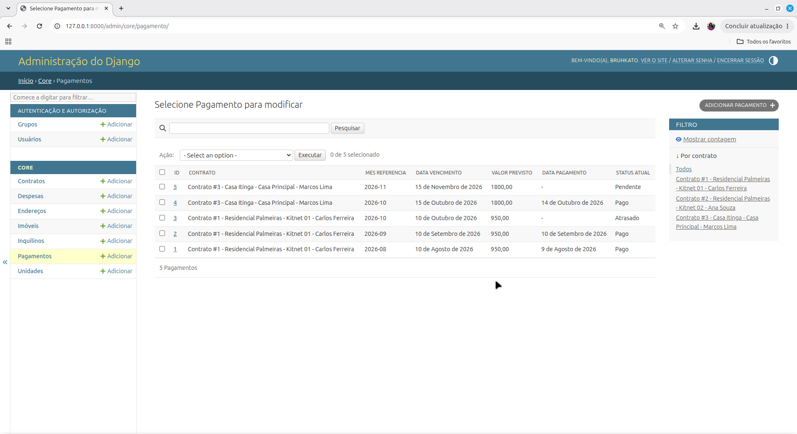
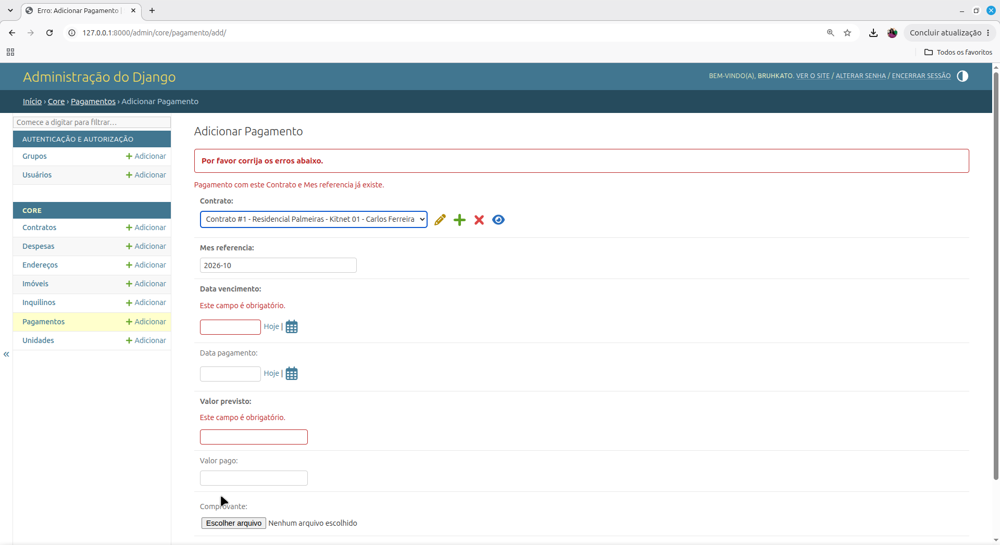

**2.5 Consultas no Django Shell**

```bash
uv run python manage.py shell
```

```python
from core.models import Imovel, Unidade, Inquilino
Imovel.objects.get(pk=1).unidades.all()
Unidade.objects.get(pk=1).status_atual
Inquilino.objects.get(pk=1).contratos.all()
```

**Commit**

```bash
git add .
git commit -m "feat(core): adiciona models, migrations, admin e dados iniciais"
```

### Etapa 3 — API REST com Django REST Framework (Aula 20)

**Objetivo:** expor os 7 models como API REST com CRUD completo, usando `ModelSerializer`, `ModelViewSet` e `DefaultRouter`.

**3.1 Instalar o DRF**

```bash
uv add djangorestframework
```

Em `config/settings.py`, acrescentar `"rest_framework"` em `INSTALLED_APPS`, antes de `"core"`.

**3.2 Serializers (`core/serializers.py`)**

O serializer converte o model em JSON (leitura) e valida o JSON recebido antes de salvar (escrita). Um serializer por model, com os campos listados explicitamente em `Meta.fields`, como na Aula 20.

Para que a resposta não mostre só números, cada relação ganha um campo **somente leitura** com o texto do registro relacionado, usando `source` (mesmo padrão do tutorial, seção 27, com `source="usuario.email"`):

```python
class ContratoSerializer(serializers.ModelSerializer):
    unidade_descricao = serializers.CharField(source="unidade", read_only=True)
    inquilino_descricao = serializers.CharField(source="inquilino", read_only=True)
    status_display = serializers.CharField(source="get_status_display", read_only=True)

    class Meta:
        model = Contrato
        fields = (
            "id",
            "unidade",
            "unidade_descricao",
            "inquilino",
            "inquilino_descricao",
            "data_inicio",
            "data_termino",
            "dia_vencimento",
            "valor_aluguel",
            "valor_caucao",
            "numero_parcelas_caucao",
            "status",
            "status_display",
        )
```

- `"unidade"` continua recebendo e devolvendo o **id**: é o que se envia no `POST`/`PUT`.
- `"unidade_descricao"` usa `source="unidade"`: o DRF converte o objeto em texto com o `__str__` do model.
- `get_status_display` é o método que o Django cria para campos com `choices`; devolve `"Ativo"` em vez de `1`.
- Os status calculados (`status_atual`) entram como `serializers.CharField(read_only=True)`, lendo a `@property` do model.

*Por que não `depth = 1`?* O `depth` mostra o objeto relacionado inteiro na leitura, mas faz o `POST`/`PUT` exigir o objeto aninhado em vez do id. Com o campo `_descricao` somente leitura, a mesma estrutura serve para ler e para escrever.

**3.3 ViewSets (`core/views.py`)**

```python
class ContratoViewSet(ExclusaoProtegidaMixin, ModelViewSet):
    queryset = Contrato.objects.all()
    serializer_class = ContratoSerializer
```

A `ModelViewSet` fornece as ações `list`, `retrieve`, `create`, `update`, `partial_update` e `destroy`, ou seja, `GET`, `POST`, `PUT`, `PATCH` e `DELETE`.

**Tratamento da exclusão protegida.** Os models usam `on_delete=PROTECT`. Sem tratamento, um `DELETE` num inquilino que tem contrato faz o banco lançar `ProtectedError`, e a API responde **500**, como se fosse um defeito do servidor. Como a recusa é uma regra esperada, ela deve virar **400** com mensagem no formato `{ "detail": ... }`:

```python
class ExclusaoProtegidaMixin:
    def destroy(self, request, *args, **kwargs):
        try:
            return super().destroy(request, *args, **kwargs)
        except ProtectedError:
            return Response(
                {
                    "detail": "Não é possível excluir este registro porque "
                    "existem outros registros vinculados a ele."
                },
                status=status.HTTP_400_BAD_REQUEST,
            )
```

O mixin entra nas ViewSets cujos registros podem ser referenciados por outros (Endereço, Imóvel, Unidade, Inquilino e Contrato). `super().destroy(...)` executa a exclusão normal da `ModelViewSet`; o `try/except` só intercepta o caso protegido.

> O material não cobre este caso. A sobrescrita de método segue o mesmo princípio usado no tutorial para `create`, `update` e `get_queryset`.

**3.4 Rotas (`config/urls.py`)**

```python
router = DefaultRouter()
router.register("enderecos", EnderecoViewSet, basename="endereco")
router.register("imoveis", ImovelViewSet, basename="imovel")
router.register("unidades", UnidadeViewSet, basename="unidade")
router.register("inquilinos", InquilinoViewSet, basename="inquilino")
router.register("contratos", ContratoViewSet, basename="contrato")
router.register("pagamentos", PagamentoViewSet, basename="pagamento")
router.register("despesas", DespesaViewSet, basename="despesa")

urlpatterns = [
    path("admin/", admin.site.urls),
    path("api/", include(router.urls)),
]
```

O `DefaultRouter` gera, para cada registro, a rota da coleção (`/api/contratos/`) e a rota do item (`/api/contratos/{id}/`), além da página `/api/` com a lista de todos os recursos.

**3.5 Testes na interface navegável do DRF**

```bash
uv run python manage.py runserver
```

| # | Teste | Requisição | Esperado |
|---|---|---|---|
| 1 | Listar unidades | `GET /api/unidades/` | `200` com `status_atual` e `imovel_descricao` |
| 2 | Detalhar contrato | `GET /api/contratos/1/` | `200` com `inquilino_descricao` e `status_display` |
| 3 | Id inexistente | `GET /api/contratos/999/` | `404` com `detail` |
| 4 | Criar contrato | `POST /api/contratos/` com o JSON da [seção 4](#exemplo-criar-um-contrato) | `201` |
| 5 | Campo obrigatório | `POST /api/contratos/` sem `inquilino` | `400` com `{"inquilino": [...]}` |
| 6 | Atualizar | `PUT /api/contratos/{id}/` mudando `valor_aluguel` | `200` |
| 7 | Excluir | `DELETE /api/contratos/{id}/` (o criado no teste 4) | `204` |
| 8 | Excluir protegido | `DELETE /api/inquilinos/1/` | `400` com `detail` (não `500`) |

Resultados:

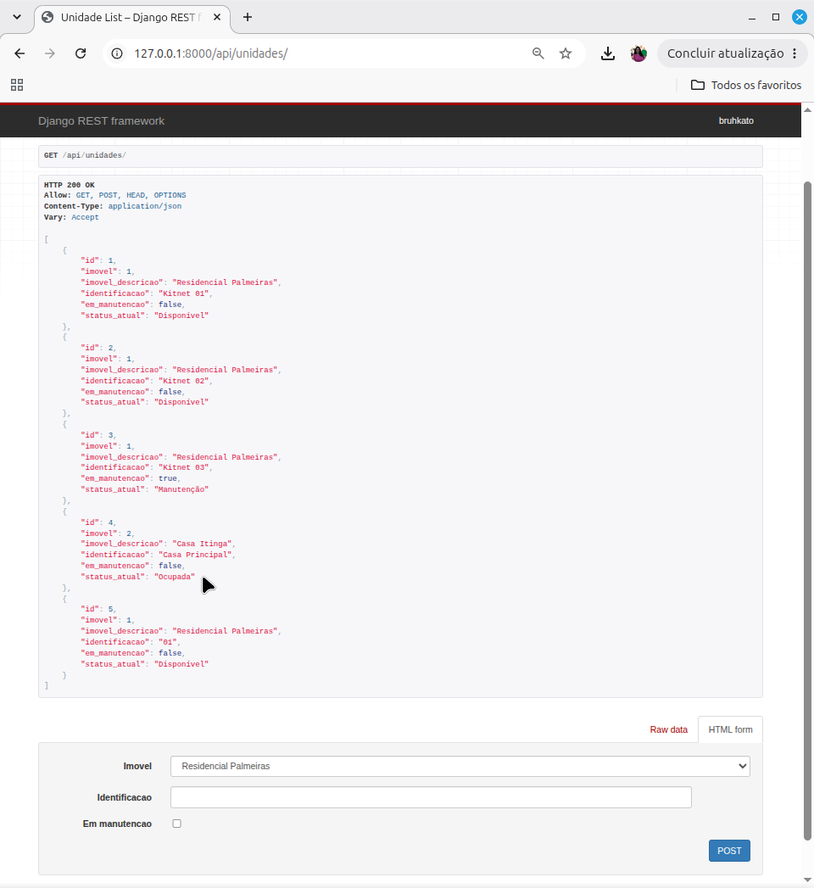

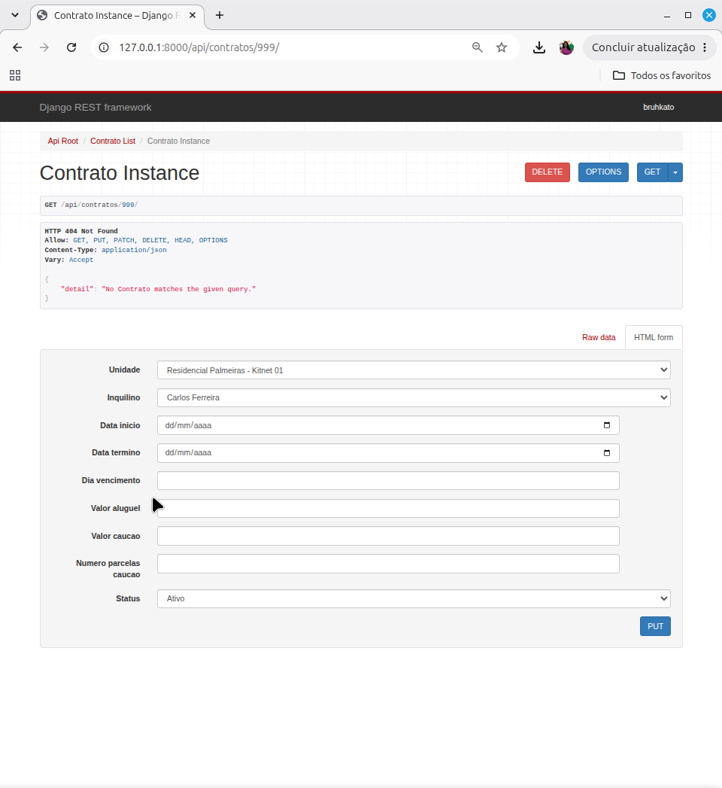

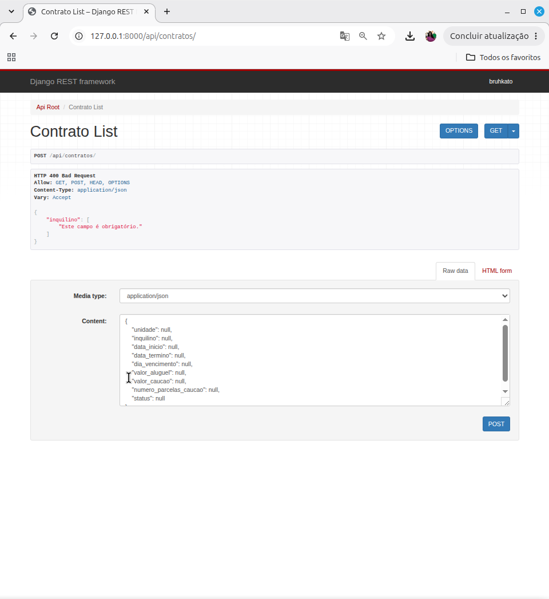

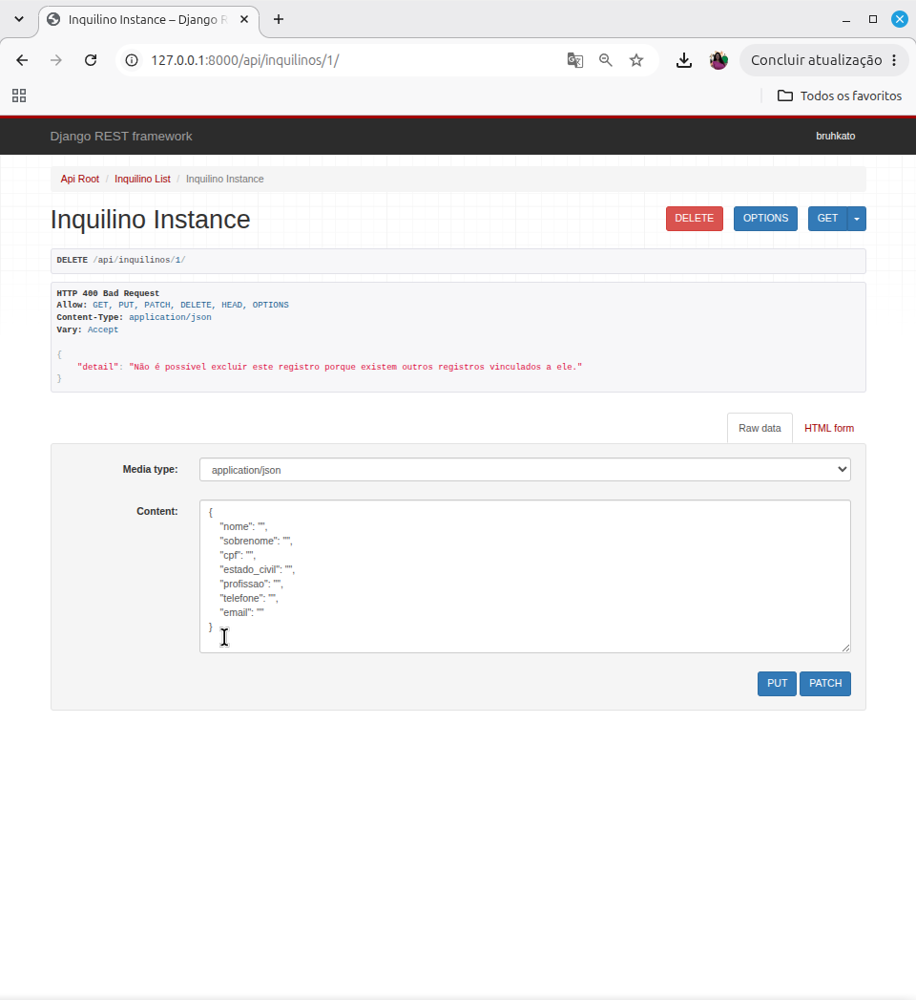

**Commit**

```bash
git add .
git commit -m "feat(drf): cria endpoints REST das entidades"
```

### Etapa 4 — Validações e regras de negócio (Aula 22)

**Objetivo:** impedir que a API aceite dados inválidos e implementar a regra de negócio do domínio, tudo antes de gravar no banco.

As validações ficam nos serializers, no padrão da Aula 22:

- **`validate_<campo>(self, value)`**: valida e normaliza **um campo**. Recebe o valor já convertido para o tipo certo (texto, número, data), devolve o valor (que pode ser ajustado, ex.: CPF formatado) ou lança `serializers.ValidationError`.
- **`validate(self, attrs)`**: valida regras que envolvem **vários campos** juntos (ex.: término depois do início, sobreposição de contratos). Recebe todos os campos já validados.

O DRF executa nesta ordem: tipos e regras do model → `validate_<campo>` → `validate` → só então salva. Se qualquer etapa falhar, nada é gravado e a resposta é `400`.

**4.1 Validação de campo**

```python
def validate_dia_vencimento(self, value):
    # Até 28, porque todo mês tem pelo menos 28 dias.
    if not 1 <= value <= 28:
        raise serializers.ValidationError("O dia de vencimento deve ser de 1 a 28.")
    return value

def validate_valor_aluguel(self, value):
    if value <= Decimal("0"):
        raise serializers.ValidationError("O valor do aluguel deve ser maior que zero.")
    return value
```

Como na Aula 22, valores monetários são comparados com `Decimal("0")`, sem converter para `float`.

Validações repetidas em vários serializers (texto mínimo, arquivo, data de pagamento) viraram funções no início do arquivo, chamadas pelos `validate_<campo>`:

```python
def validar_texto_minimo(valor, minimo=2):
    texto = valor.strip()
    if len(texto) < minimo:
        raise serializers.ValidationError(f"Informe pelo menos {minimo} caracteres.")
    return texto
```

**4.2 CPF: validar, formatar e conferir unicidade**

```python
def validate_cpf(self, value):
    digitos = somente_digitos(value)
    if not cpf_valido(digitos):
        raise serializers.ValidationError("CPF inválido.")
    cpf = f"{digitos[:3]}.{digitos[3:6]}.{digitos[6:9]}-{digitos[9:]}"
    mesmos_cpfs = Inquilino.objects.filter(cpf=cpf)
    if self.instance is not None:
        mesmos_cpfs = mesmos_cpfs.exclude(pk=self.instance.pk)
    if mesmos_cpfs.exists():
        raise serializers.ValidationError("Já existe um inquilino com este CPF.")
    return cpf
```

O CPF é aceito com ou sem pontuação, mas é gravado sempre formatado. Por isso a unicidade é conferida **depois** da formatação: sem isso, `11144477735` passaria pela verificação automática do DRF (que compara o texto como foi enviado) e o banco recusaria `111.444.777-35` duplicado com erro 500.

`self.instance` é o registro sendo editado (no `PUT`/`PATCH`) ou `None` (no `POST`). Excluí-lo da busca evita que um inquilino seja recusado por "duplicar" o próprio CPF.

**4.3 Regra de negócio: contratos sobrepostos**

```python
def validate(self, attrs):
    # Num PATCH só chegam os campos enviados; os demais vêm do contrato atual.
    def valor(campo):
        if campo in attrs:
            return attrs[campo]
        return getattr(self.instance, campo, None)

    unidade = valor("unidade")
    data_inicio = valor("data_inicio")
    data_termino = valor("data_termino")
    status = valor("status")
    if status is None:
        status = Contrato.Status.ATIVO

    if data_termino <= data_inicio:
        raise serializers.ValidationError(
            {"data_termino": "A data de término deve ser posterior à data de início."}
        )

    if status != Contrato.Status.ATIVO:
        return attrs

    # Regra de negócio 1: unidade em manutenção não recebe contrato novo.
    unidade_mudou = self.instance is None or self.instance.unidade_id != unidade.id
    if unidade.em_manutencao and unidade_mudou:
        raise serializers.ValidationError(
            {"unidade": "Esta unidade está em manutenção e não pode receber um novo contrato."}
        )

    # Regra de negócio 2: uma unidade não pode ter dois contratos ativos
    # com períodos que se sobrepõem.
    conflitos = Contrato.objects.filter(
        unidade=unidade,
        status=Contrato.Status.ATIVO,
        data_inicio__lte=data_termino,
        data_termino__gte=data_inicio,
    )
    if self.instance is not None:
        conflitos = conflitos.exclude(pk=self.instance.pk)
    conflito = conflitos.first()
    if conflito:
        raise serializers.ValidationError(
            {
                "unidade": (
                    f"Esta unidade já tem o contrato #{conflito.id} ativo de "
                    f"{conflito.data_inicio:%d/%m/%Y} a {conflito.data_termino:%d/%m/%Y}, "
                    "que se sobrepõe ao período informado."
                )
            }
        )
    return attrs
```

- A consulta usa `__lte` e `__gte`, os mesmos lookups da Aula 23, para aplicar a condição de sobreposição direto no banco.
- O erro é lançado como dicionário (`{"unidade": ...}`) para a mensagem aparecer no campo envolvido, e não num erro genérico.
- A função `valor()` resolve o `PATCH`: se o cliente só mudar o `status`, as datas e a unidade vêm do contrato salvo.
- Reativar um contrato rescindido (`PATCH` com `"status": 1`) também passa pela regra: se outro contrato ativo ocupar o mesmo período, a reativação é recusada.

**4.4 Testes**

Com os dados de exemplo carregados (`loaddata dados_iniciais`) e o contrato #1 como **Ativo**:

| # | Teste | Requisição | Esperado |
|---|---|---|---|
| 1 | Contrato sobreposto | `POST /api/contratos/` na unidade 1, de `2026-12-01` a `2027-11-30` (JSON abaixo) | `400` em `unidade`, citando o contrato #1 |
| 2 | Contrato sem sobreposição | mesmo JSON, com datas `2027-12-01` a `2028-11-30` | `201` |
| 3 | Unidade em manutenção | mesmo JSON, com `"unidade": 3` | `400` em `unidade` |
| 4 | Término antes do início | mesmo JSON, com `"data_termino": "2026-11-01"` | `400` em `data_termino` |
| 5 | Dia de vencimento inválido | mesmo JSON, com `"dia_vencimento": 31` | `400` em `dia_vencimento` |
| 6 | Rescindir libera a unidade | `PATCH /api/contratos/1/` com `{"status": 3}`, depois `GET /api/unidades/1/` | `status_atual` = `Disponível` |
| 7 | Novo contrato na unidade liberada | repetir o `POST` do teste 1 | agora `201` (o #1 está rescindido) |
| 8 | Reativar com conflito | `PATCH /api/contratos/1/` com `{"status": 1}` | `400` em `unidade`, citando o contrato do teste 7 |
| 9 | CPF inválido | `POST /api/inquilinos/` com `"cpf": "123.456.789-00"` | `400` em `cpf` |
| 10 | CPF duplicado sem pontuação | `POST /api/inquilinos/` com `"cpf": "11144477735"` | `400` em `cpf` |
| 11 | Mês fora da vigência | `POST /api/pagamentos/` no contrato 1 com `"mes_referencia": "2025-12"` | `400` em `mes_referencia` |
| 12 | Pagamento sem valor | `PATCH /api/pagamentos/3/` com só `{"data_pagamento": "2026-10-20"}` | `400` em `valor_pago` |
| 13 | Unidade de outro imóvel | `POST /api/despesas/` com `"imovel": 2, "unidade": 1` | `400` em `unidade` |

Resultados:

Teste 1, contrato sobreposto recusado:

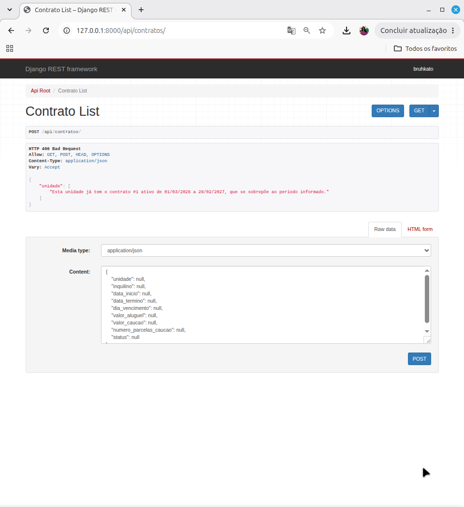

Teste 6, rescisão do contrato #1 e Kitnet 01 liberada:

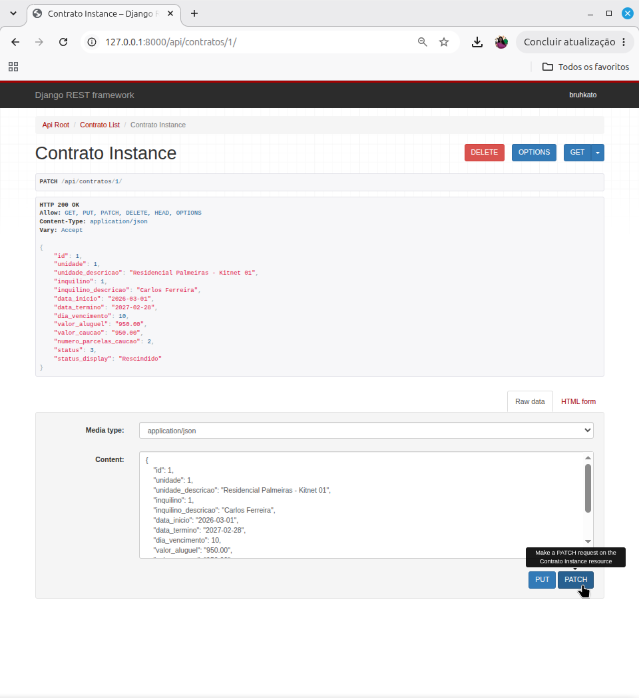
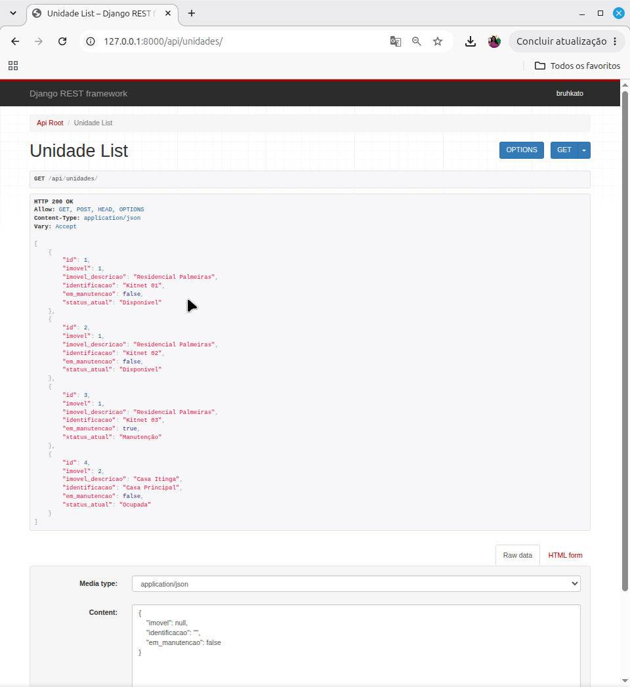

Teste 7, novo contrato aceito na unidade liberada:

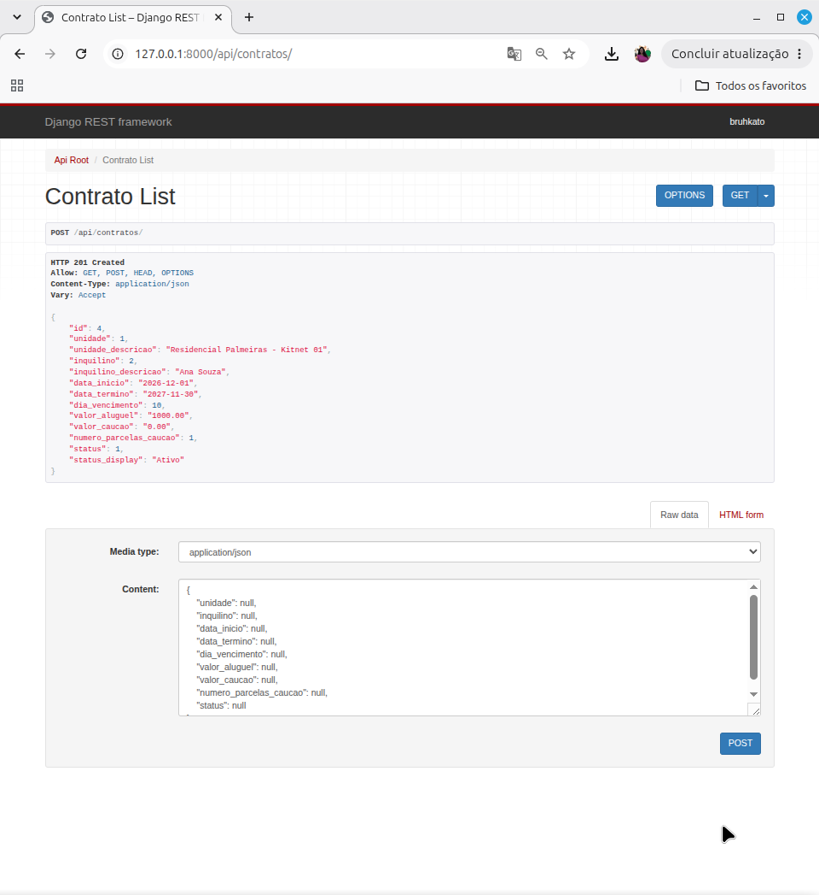

Testes 9, 11 e 12, validações de CPF, vigência e pagamento:

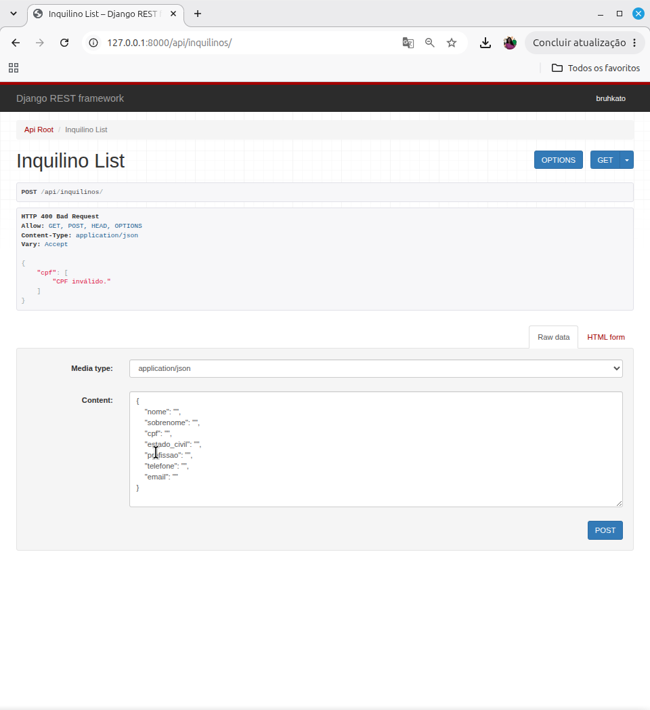
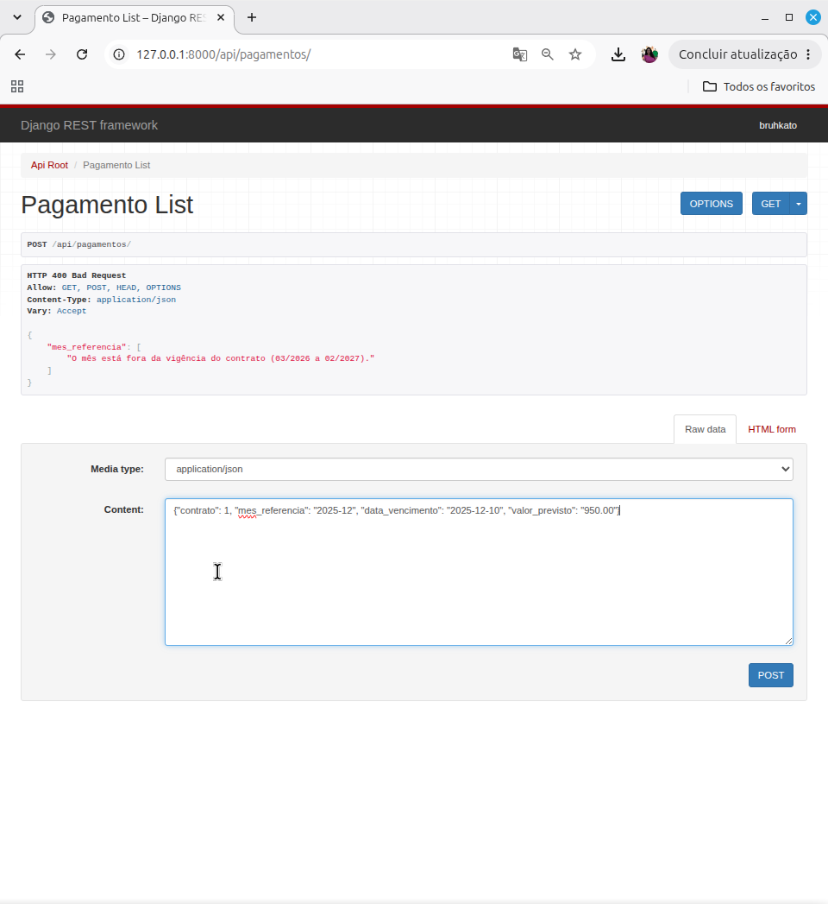
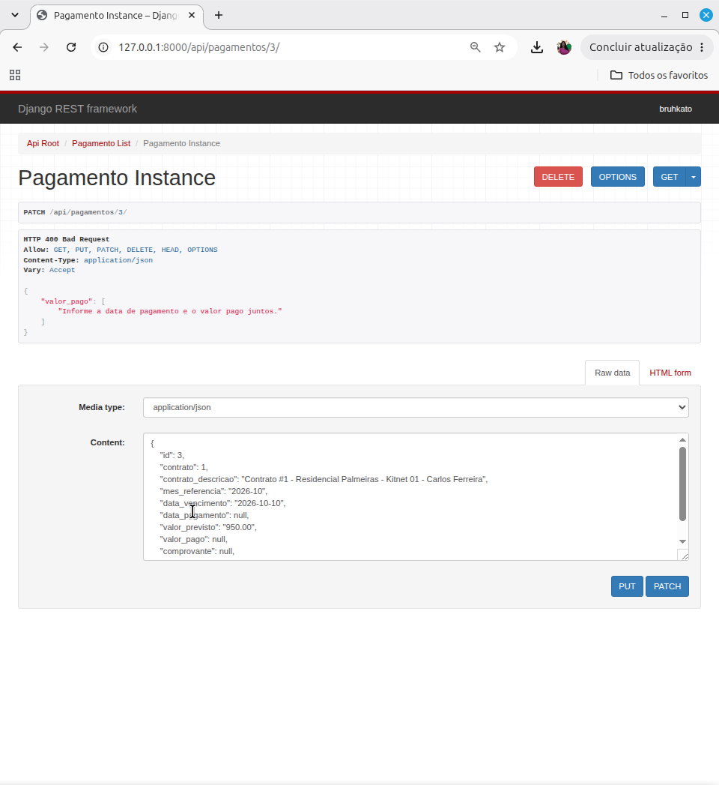

Ao final, para voltar aos dados de exemplo: excluir os contratos criados nos testes 2 e 7 (`DELETE`) e reativar o #1 (`PATCH` com `{"status": 1}`). Ou recriar o banco com `rm db.sqlite3`, `migrate` e `loaddata dados_iniciais`.

JSON do teste 1:

```json
{
  "unidade": 1,
  "inquilino": 2,
  "data_inicio": "2026-12-01",
  "data_termino": "2027-11-30",
  "dia_vencimento": 10,
  "valor_aluguel": "1000.00",
  "valor_caucao": "0.00",
  "numero_parcelas_caucao": 1,
  "status": 1
}
```

**Commit**

```bash
git add .
git commit -m "feat(api): adiciona validações e regras de negócio"
```

### Etapa 5 — Filtros, busca, ordenação e paginação (Aulas 23, 24 e 25)

**Objetivo:** permitir consultar os dados além do `GET` da coleção, com os mesmos parâmetros e o mesmo formato de paginação construídos nas Partes 1 a 6 da disciplina.

**5.1 Instalar o django-filter**

```bash
uv add django-filter
```

Em `config/settings.py`, acrescentar `"django_filters"` em `INSTALLED_APPS` e criar o bloco `REST_FRAMEWORK`:

```python
REST_FRAMEWORK = {
    # Filtros (Aula 23), busca e ordenação (Aula 24) valem para todas as ViewSets.
    # Cada ViewSet define seus campos com filterset_class, search_fields e ordering_fields.
    "DEFAULT_FILTER_BACKENDS": [
        "django_filters.rest_framework.DjangoFilterBackend",
        "rest_framework.filters.SearchFilter",
        "rest_framework.filters.OrderingFilter",
    ],
    # Paginação (Aula 25)
    "DEFAULT_PAGINATION_CLASS": "core.pagination.PaginacaoPadrao",
    "PAGE_SIZE": 10,
}
```

Na Aula 24, os três backends são declarados em cada ViewSet (`filter_backends = (...)`). Como aqui são 7 ViewSets, eles foram declarados uma vez só, no `DEFAULT_FILTER_BACKENDS` (a mesma chave usada na Aula 23). O efeito é o mesmo.

**5.2 Filtros (`core/filters.py`)**

Um `FilterSet` por recurso, como o `ProdutoFilter` da Aula 23:

```python
class DespesaFilter(filters.FilterSet):
    em_aberto = filters.BooleanFilter(field_name="data_pagamento", lookup_expr="isnull")
    valor_minimo = filters.NumberFilter(field_name="valor", lookup_expr="gte")
    valor_maximo = filters.NumberFilter(field_name="valor", lookup_expr="lte")
    vencimento_minimo = filters.DateFilter(field_name="data_vencimento", lookup_expr="gte")
    vencimento_maximo = filters.DateFilter(field_name="data_vencimento", lookup_expr="lte")

    class Meta:
        model = Despesa
        fields = (
            "imovel",
            "unidade",
            "categoria",
            "em_aberto",
            "valor_minimo",
            "valor_maximo",
            "vencimento_minimo",
            "vencimento_maximo",
        )
```

- `field_name` é a coluna do banco e `lookup_expr` é a comparação: `gte` (maior ou igual), `lte` (menor ou igual), `iexact` (igual, sem diferenciar maiúsculas), `isnull` (é nulo).
- `em_aberto=true` vira `data_pagamento IS NULL`: é assim que se encontram os **boletos em aberto**.
- Campos listados só em `Meta.fields` (ex.: `imovel`, `categoria`) viram filtros exatos automaticamente.
- Relações também podem ser filtradas: `filters.NumberFilter(field_name="unidade__imovel")` filtra contratos pelo imóvel da unidade.
- Valor inválido (ex.: `?valor_minimo=abc`) devolve `400` com a mensagem do campo.

**5.3 Busca e ordenação (nas ViewSets)**

```python
class ContratoViewSet(ExclusaoProtegidaMixin, ModelViewSet):
    queryset = Contrato.objects.all()
    serializer_class = ContratoSerializer
    filterset_class = ContratoFilter
    search_fields = (
        "inquilino__nome",
        "inquilino__sobrenome",
        "unidade__identificacao",
        "unidade__imovel__nome_imovel",
    )
    ordering_fields = ("id", "data_inicio", "data_termino", "valor_aluguel", "status")
    ordering = ("id",)
```

- `search_fields`: campos de **texto** consultados pelo `?search=`, com busca parcial e sem diferenciar maiúsculas. Aceita campos de outras tabelas com `__` (ex.: `inquilino__nome`). Campos numéricos ficam de fora, pelo mesmo motivo do `estoque` na Aula 15.
- `ordering_fields`: campos permitidos no `?ordering=`.
- `ordering`: ordem padrão. Também é necessária para a paginação: sem ordem definida, a mesma consulta pode trazer os registros em ordem diferente e repetir itens entre páginas.

**5.4 Paginação (`core/pagination.py`)**

A classe é a da Aula 25 (renomeada para `PaginacaoPadrao`), que devolve `{ page, page_size, total_pages, results }` em vez do formato padrão do DRF (`count`, `next`, `previous`, `results`):

```python
class PaginacaoPadrao(PageNumberPagination):
    page_size_query_param = "page_size"
    max_page_size = 100

    def paginate_queryset(self, queryset, request, view=None):
        self.request = request
        page_size_param = request.query_params.get(self.page_size_query_param)
        if page_size_param is not None:
            try:
                if int(page_size_param) > self.max_page_size:
                    raise ValidationError(
                        {"page_size": "O campo page_size não pode passar de 100."}
                    )
            except ValueError:
                pass

        page_size = self.get_page_size(request)
        if page_size is None:
            return None

        self.paginator = self.django_paginator_class(queryset, page_size)
        try:
            self.page_number = int(request.query_params.get(self.page_query_param, 1))
        except (TypeError, ValueError):
            raise ValidationError({"page": "Informe um número inteiro positivo."})

        if self.page_number < 1:
            raise ValidationError({"page": "Informe um número inteiro positivo."})

        self.total_pages = ceil(self.paginator.count / page_size)
        if self.total_pages == 0 or self.page_number > self.total_pages:
            self.page = None
            return []

        self.page = self.paginator.page(self.page_number)
        return list(self.page)

    def get_paginated_response(self, data):
        return Response(
            {
                "page": self.page_number,
                "page_size": self.paginator.per_page,
                "total_pages": self.total_pages,
                "results": data,
            }
        )
```

> O código da Aula 25, no material, tem um erro de indentação no bloco que valida o `page_size`; aqui ele foi corrigido sem mudar a lógica.

Foi acrescentado também o método `get_paginated_response_schema`, que não está na Aula 25. Ele descreve esse formato para a documentação OpenAPI; sem ele, o Swagger da Etapa 6 mostraria o formato padrão do DRF (`count`, `next`…), diferente do que a API realmente devolve.

**5.5 Testes**

| # | Requisição | Esperado |
|---|---|---|
| 1 | `GET /api/contratos/` | `200` com `page`, `page_size`, `total_pages`, `results` |
| 2 | `GET /api/contratos/?status=1` | só contratos ativos |
| 3 | `GET /api/contratos/?valor_minimo=1000` | só aluguéis a partir de R$ 1.000 |
| 4 | `GET /api/contratos/?search=carlos` | contrato do Carlos Ferreira |
| 5 | `GET /api/contratos/?ordering=-valor_aluguel` | do maior aluguel para o menor |
| 6 | `GET /api/despesas/?em_aberto=true&ordering=data_vencimento` | boletos não pagos, do vencimento mais próximo |
| 7 | `GET /api/pagamentos/?contrato=1&ordering=-mes_referencia` | pagamentos do contrato 1, do mês mais recente |
| 8 | `GET /api/unidades/?page_size=2&page=2` | 2 unidades, `page: 2`, `total_pages: 2` |
| 9 | `GET /api/unidades/?page=99` | `200` com `results: []` |
| 10 | `GET /api/unidades/?page=0` | `400` em `page` |
| 11 | `GET /api/unidades/?page_size=101` | `400` em `page_size` |
| 12 | `GET /api/contratos/?valor_minimo=abc` | `400` em `valor_minimo` |
| 13 | `GET /api/contratos/?status=1&search=residencial&ordering=-data_inicio&page_size=5` | filtros, busca, ordenação e paginação combinados |

**Commit**

```bash
git add .
git commit -m "feat(api): adiciona filtros, busca, ordenação e paginação"
```

---

## 6. Checklist da Parte 8

**Obrigatório**

- [x] Escolhi um domínio próprio, diferente da simples reprodução da API de Produtos.
- [x] Implementei `GET` da coleção, `GET` individual, `POST`, `PUT` e `DELETE`.
- [x] Utilizei códigos HTTP adequados e respostas em JSON quando aplicável.
- [x] Os dados estão persistidos em um banco de dados.
- [x] Defini e implementei validações no backend.
- [x] Implementei pelo menos uma regra de negócio além do CRUD.
- [x] Implementei filtro, busca textual, ordenação e paginação.
- [ ] Documentei a API e as instruções de execução.
- [x] Versionei o código em um repositório Git.
- [ ] Informei todas as URLs necessárias para avaliação.
- [ ] Preparei a demonstração e a explicação do projeto para a apresentação obrigatória.
- [ ] Realizei a entrega pelo SIGAA, enviando o link do repositório GitHub do projeto.
- [ ] Estou preparado para apresentar o projeto em sala de aula, para toda a turma, após a data de entrega.
- [ ] Testei a aplicação após instalar e configurar o projeto seguindo o `README`.

**Opcional**

- [ ] Publiquei a aplicação.
- [ ] Criei um frontend integrado à API.
- [x] Implementei 3 ou mais models/tabelas relevantes para o domínio.
- [ ] Implementei e testei login, autenticação e acesso a pelo menos um recurso protegido.
- [x] Removi do repositório credenciais, senhas e chaves privadas.
